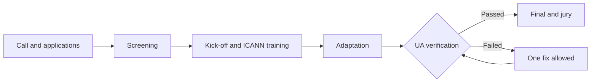

# Program

**UA-Ready Türkiye 2027 gives ICANN's "Adoption & Demonstration" UA Day event type a competition format: a compliance call for existing projects.**

## How it differs from a hackathon

| Dimension | Classic hackathon | UA Compliance Call |
| --- | --- | --- |
| Project source | Built from scratch at the event | Existing, working projects |
| Duration | 48 hours | About 8 weeks (4 weeks of adaptation) |
| Scope | Web application | Web, mobile, desktop, email, library, API |
| Goal | Win votes or investment | Prove UA compliance |
| Final entry | All teams | Only teams that pass UA verification |
| Judging | Votes or virtual investment | Expert jury, weighted scorecard |
| Lasting impact | Prototype ends with the event | Real product stays UA-ready, case study published |

## Flow

## How ICANN requirements are met

- **IDN domain:** The program site and test environments run on a domain name with Turkish characters.
- **EAI mail server:** A Linux server built with ICANN's self-hosting script provides test addresses with Turkish characters.
- **UA-ready website:** Application and results pages work with UA-ready behavior.
- **Awareness session and ICANN video:** Part of the opening of the final day.
- **Documentation:** Finalists' experiences are published as case studies.

## Support

Teams are not left alone: ICANN technical training, a 3-hour introduction to the email system, weekly mentor hours, a test area with Turkish characters per team and a shared communication channel.
