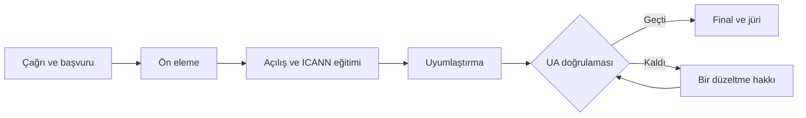

# Program

**UA-Hazır Türkiye 2027, ICANN'in UA Day etkinlik serisinin "Adoption & Demonstration" (uygulama ve gösterim) türüne yarışma formatı kazandıran bir uyum çağrısıdır.**

## Hackathondan farkı

| Boyut | Klasik hackathon | UA Uyum Çağrısı |
| --- | --- | --- |
| Proje kaynağı | Etkinlikte sıfırdan yazılır | Daha önce geliştirilmiş, çalışan projeler |
| Süre | 48 saat | Yaklaşık 8 hafta (4 hafta uyumlaştırma) |
| Kapsam | Web uygulaması | Web, mobil, masaüstü, e-posta, kütüphane, API |
| Hedef | Beğeni veya yatırım toplamak | UA uyumunu kanıtlamak |
| Finale giriş | Tüm takımlar | Yalnızca UA doğrulamasını geçenler |
| Değerlendirme | Oy veya sanal yatırım | Uzman jüri, ağırlıklı puan tablosu |
| Kalıcı etki | Prototip etkinlikle biter | Gerçek ürün UA-hazır kalır, vaka çalışması çıkar |

## Akış

## ICANN gereksinimleri nasıl karşılanıyor?

- **IDN alan adı:** Program sitesi ve test ortamları Türkçe karakterli alan adı üzerinde çalışır.
- **EAI e-posta sunucusu:** ICANN'in yayımladığı self-hosting script'iyle kurulan Linux sunucu, Türkçe karakterli test adresleri sağlar.
- **UA-uyumlu web sitesi:** Başvuru ve sonuç sayfaları UA-uyumlu çalışır.
- **Farkındalık oturumu ve ICANN videosu:** Final gününün açılışında yer alır.
- **Belgeleme:** Finalistlerin deneyimleri vaka çalışması olarak yayımlanır.

## Destek

Ekipler yalnız bırakılmaz: ICANN teknik eğitimi, e-posta sistemi tanıtımı (3 saat), haftalık mentor saatleri, her ekibe Türkçe karakterli test alanı ve ortak bir iletişim kanalı sağlanır.
