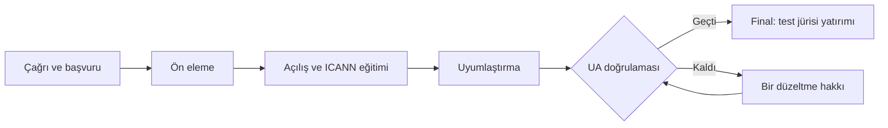

# Program

**UA-Hazır Türkiye 2027, ICANN'in UA Day etkinlik serisinin "Adoption & Demonstration" (uygulama ve gösterim) türüne yarışma formatı kazandıran bir uyum çağrısıdır.**

## Klasik hackathondan farkı

| Boyut | Klasik hackathon | UA Uyum Çağrısı |
| --- | --- | --- |
| Proje kaynağı | Etkinlikte sıfırdan yazılır | Daha önce geliştirilmiş, çalışan projeler |
| Süre | 48 saat | Yaklaşık 4 hafta uyumlaştırma, ardından tek günlük final |
| Kapsam | Web uygulaması | Web, mobil, masaüstü, e-posta, kütüphane, API |
| Hedef | Kullanıcıyı ikna edip yatırım almak | UA uyumunu kanıtlamak ve test jürisini ikna edip yatırım almak |
| Finale giriş | Tüm takımlar | Yalnızca UA doğrulamasını geçenler |
| Değerlendirme | Sanal yatırım | 20 kişilik test jürisinin sanal yatırımı |
| Kalıcı etki | Prototip etkinlikle biter | Gerçek ürün UA-hazır kalır, vaka çalışması çıkar |

## Akış

## Uygulama sisteme nasıl girer?

- **Türkçe karakterli ad:** Takımlar projelerini sisteme Türkçe karakter içeren adlarla ekler; test jürisi projeleri bu adlarla görür.
- **Mail sistemi entegrasyonu:** Projeler, organizasyonun kurduğu Türkçe karakterli e-posta adreslerini destekleyen mail sistemiyle çalışmalıdır.
- **Yayın:** Projenin internette yayımlanması zorunlu değildir. İsteyen takım kendisi yayımlayabilir.

## ICANN gereksinimleri nasıl karşılanıyor?

- **IDN alan adı:** Program sitesi ve test ortamları Türkçe karakterli alan adı üzerinde çalışır.
- **EAI e-posta sunucusu:** ICANN'in yayımladığı self-hosting script'iyle kurulan Linux sunucu, Türkçe karakterli test adresleri sağlar.
- **UA-uyumlu web sitesi:** Başvuru ve sonuç sayfaları UA-uyumlu çalışır.
- **Farkındalık oturumu ve ICANN videosu:** Final gününün açılışında yer alır.
- **Belgeleme:** Finalistlerin deneyimleri vaka çalışması olarak yayımlanır.

## Destek

Ekipler yalnız bırakılmaz: ICANN teknik eğitimi, e-posta sistemi tanıtımı (3 saat), haftalık mentor saatleri, her ekibe Türkçe karakterli test alanı ve ortak bir iletişim kanalı sağlanır. Katılan herkes **katılım sertifikası** alır.
