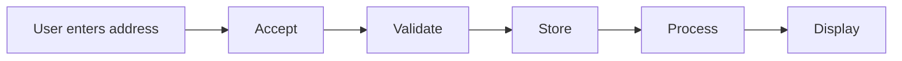

# Universal Acceptance

**Universal Acceptance is the requirement that every valid domain name and email address works equally in every application, regardless of language, script or length.**

## Why it matters for Turkish

Turkish characters (`ç ğ ı İ ö ş ü`) cause problems in three places:

| Problem | Example | Expected |
| --- | --- | --- |
| Form rejects it | `şükrü@örnek.com` is called "invalid" | Must be accepted |
| Case conversion | `İSPARTA` and `ısparta` get mixed up | Handled with locale-aware rules |
| Not delivered | Notification email disappears | EAI-capable server and client |

## Five steps

When software meets a domain name or email address, it must get five things right:

### Accept
Input fields do not reject the address.

### Validate
Validation rules (regex, libraries) know Unicode, long and new TLDs.

### Store
Databases and logs keep it intact in UTF-8.

### Process
A-label and U-label conversion (Punycode) and case conversion are correct.

### Display
The address is readable in the interface, emails and documents.

## Short glossary

| Term | Meaning |
| --- | --- |
| IDN | Internationalized domain name (`çiçek.com.tr`) |
| EAI | Email address internationalization; local part and domain can be Unicode |
| U-label / A-label | Unicode and Punycode (`xn--`) forms of a domain name |
| SMTPUTF8 | SMTP extension that carries Unicode email addresses |

More in [Resources](kaynaklar.md).
